# Automated playtest report

Generated 2026-11-04 12:26 by `node tools/playtest.mjs learn`. Two bots per level: a **novice** that follows the tutorial and advisor hints, and a **learned planner** whose dials have been tuned by trial and error (see `tools/playtest-brain.json`). Bots only use player actions. They show what is *possible* and where play *stalls*; they cannot judge fun or clarity — that still needs people.

| Level | Novice | Learned planner | Planner time | Citadel | Stars | Families lost (novice / planner) | Burned |
|---|---|---|---|---|---|---|---|
| 1. Dawn at Anuradhapura | won | won | 298s | 100% | ★★★ | 0 / 0 | 0 |
| 2. Elephants of Ruhuna | won | won | 311s | 98% | ★★★ | 0 / 0 | 0 |
| 3. The Dry Zone | won | won | 410s | 100% | ★★★ | 0 / 0 | 0 |
| 4. Lion Rock | won | won | 499s | 100% | ★★★ | 0 / 0 | 1 |
| 5. The Disawa's Dam | won | won | 436s | 94% | ★★★ | 0 / 0 | 0 |
| 6. Sea of Parakrama | won | won | 509s | 100% | ★★ | 0 / 0 | 0 |
| 7. Hill Kingdom | won | won | 723s | 100% | ★★★ | 0 / 0 | 1 |

## Findings

- **L1 Dawn at Anuradhapura:** both bots won with the citadel almost untouched (100% / 100%). Raids may be too weak to create tension here.
- **L2 Elephants of Ruhuna:** both bots won with the citadel almost untouched (100% / 98%). Raids may be too weak to create tension here.
- **L2 Elephants of Ruhuna:** on average 47% of villagers were idle (no job). Idle people have nothing to do; consider jobs that use them (hauling, festival crowds, militia) or a cost to idleness.
- **L4 Lion Rock:** both bots won with the citadel almost untouched (100% / 100%). Raids may be too weak to create tension here.
- **L5 The Disawa's Dam:** on average 49% of villagers were idle (no job). Idle people have nothing to do; consider jobs that use them (hauling, festival crowds, militia) or a cost to idleness.
- **Tribute:** the learner almost never pays it (dial 0.05). Either it is priced too high or fighting is too easy.
- **Defence the learner relies on:** 2.3 towers per raid edge, 6.9 wall tiles, an army of 7.8 + 4.1 per raid. 
- **Economy the learner prefers:** 1.09 paddies per house, at most 12 houses, 2.6 woodcutters.

## Bot limits (so findings aren't over-read)

- The bots never open sluices, never use forest ambush on purpose, never repair or upgrade except for harmony, and never call raids early. The planner does send its melee soldiers out against stone throwers.
- They place buildings by simple rules (near the citadel, near water or forest), not by reading the map like a person.
- Raids involve randomness; a single run per bot is a sample, not a verdict. Learning averages several runs per candidate.

## Learning history

- L1: 40 generations, best score 1385; recent 1385 → 1385 → 1385 → 1385 → 1385
- L2: 12 generations, best score 1385; recent 1383 → 1384 → 1384 → 1385 → 1385
- L3: 43 generations, best score 1379; recent 1379 → 1379 → 1379 → 1379 → 1379
- L4: 43 generations, best score 1375; recent 1375 → 1375 → 1374 → 1375 → 1375
- L5: 12 generations, best score 1375; recent 1376 → 1376 → 1375 → 1375 → 1375
- L6: 43 generations, best score 1275; recent 1275 → 1275 → 1275 → 1275 → 1275
- L7: 53 generations, best score 1364; recent 1364 → 1364 → 1364 → 1364 → 1364

## Screens (learned planner)

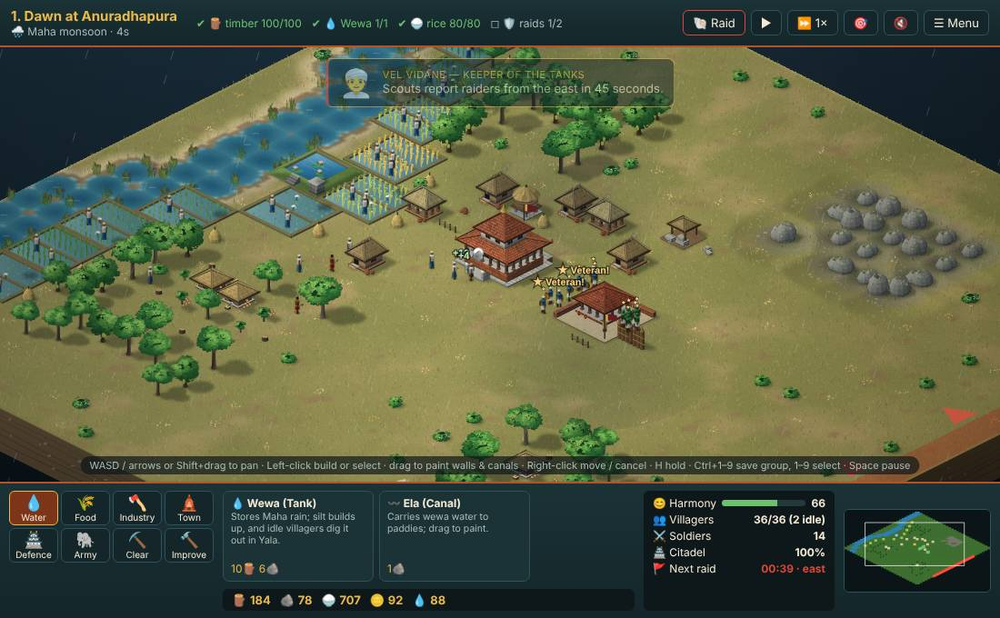
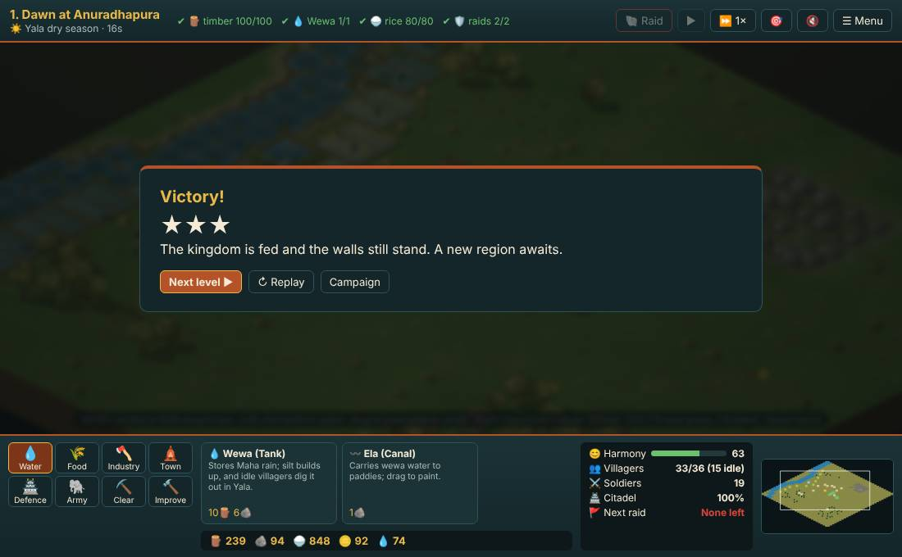
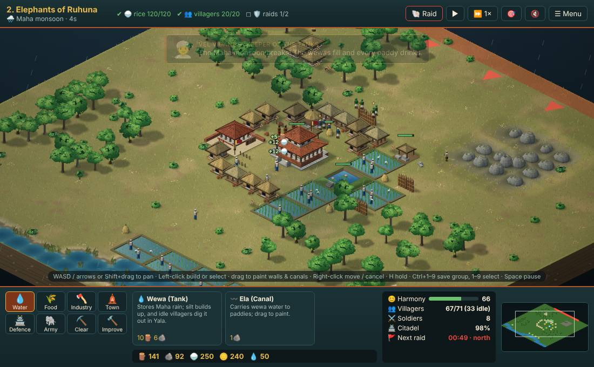
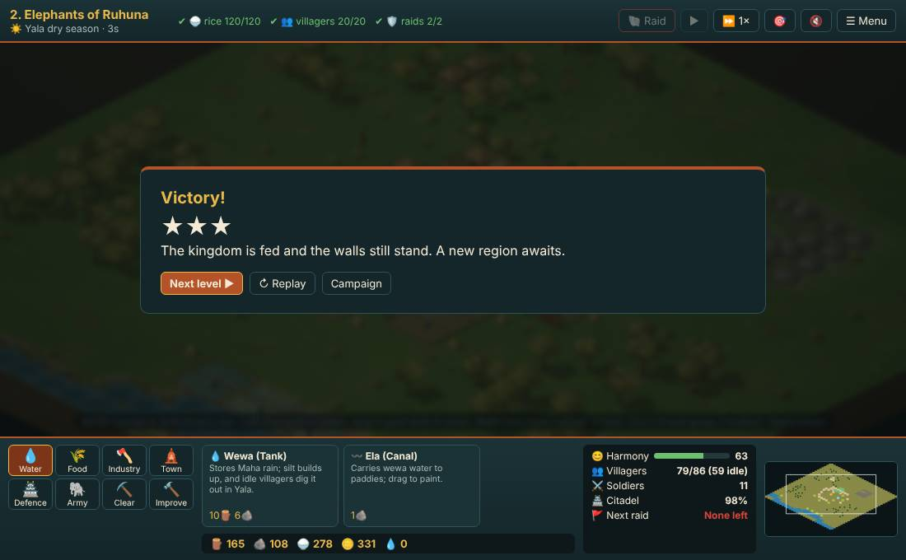
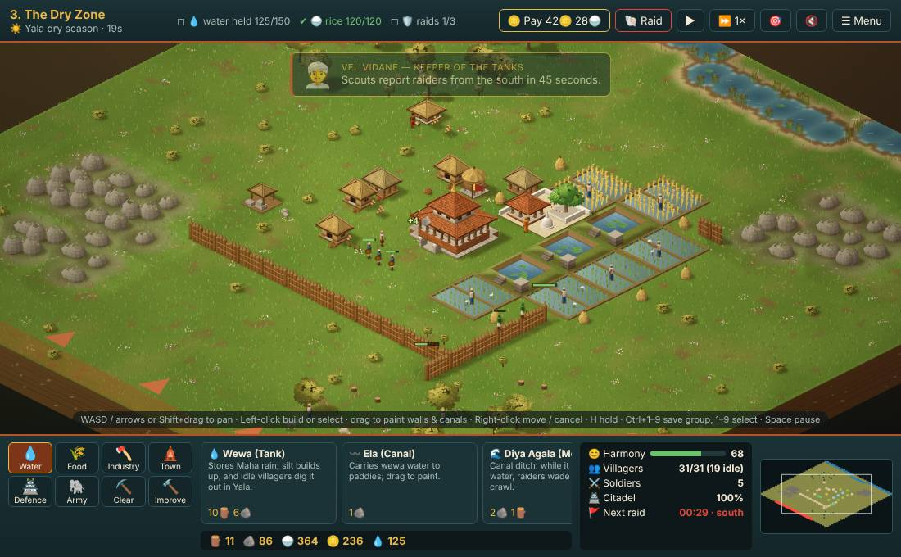
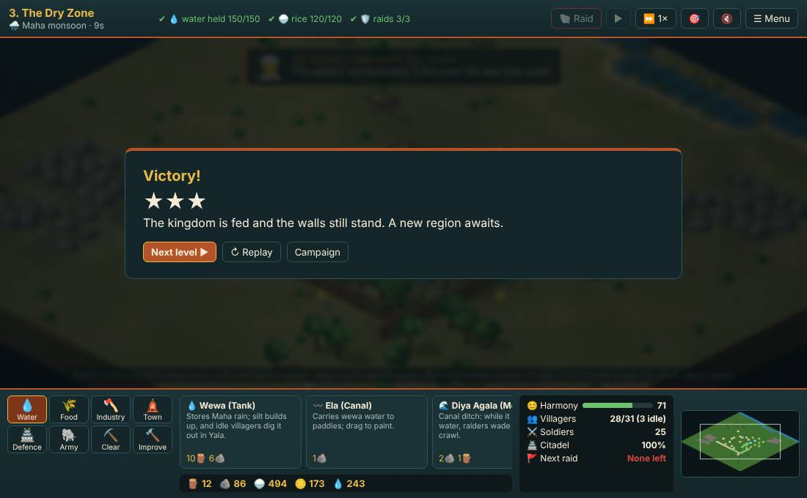
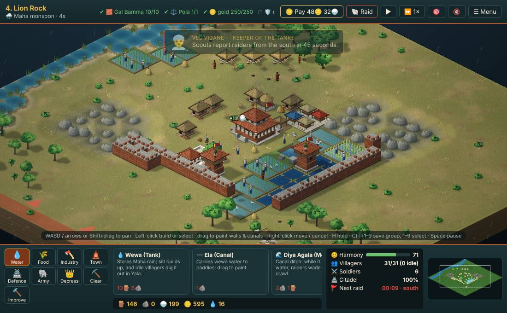
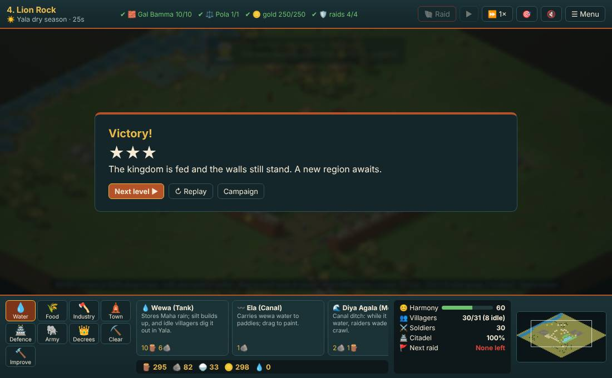
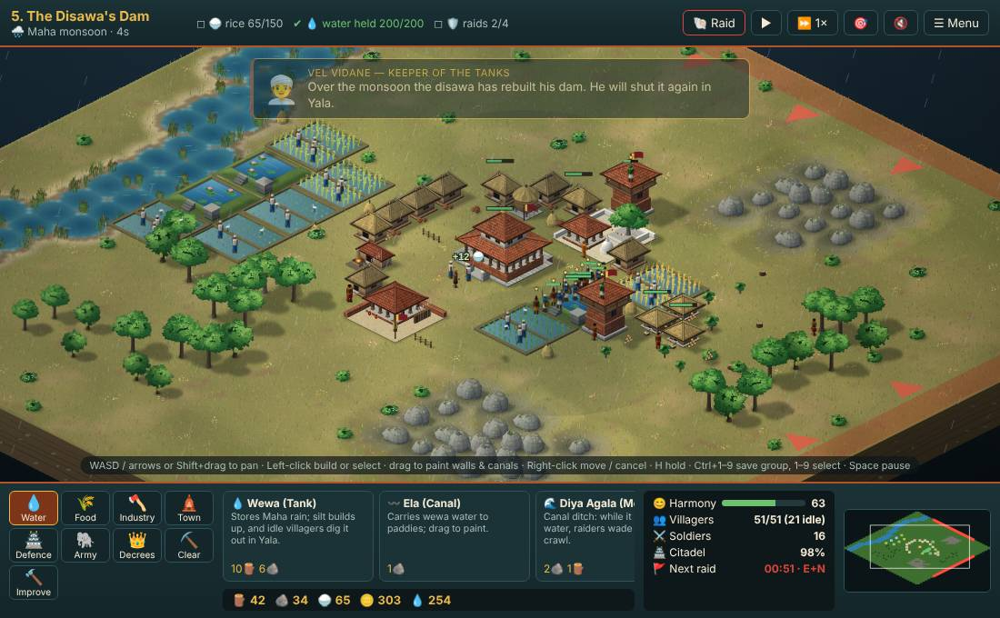
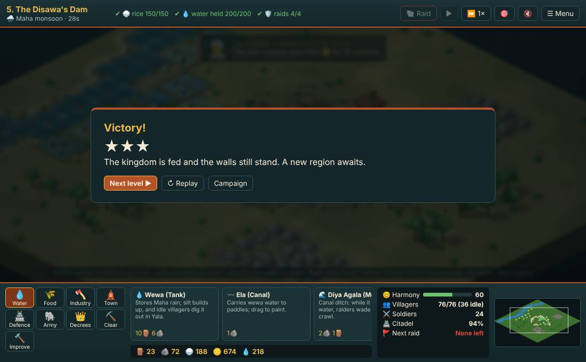
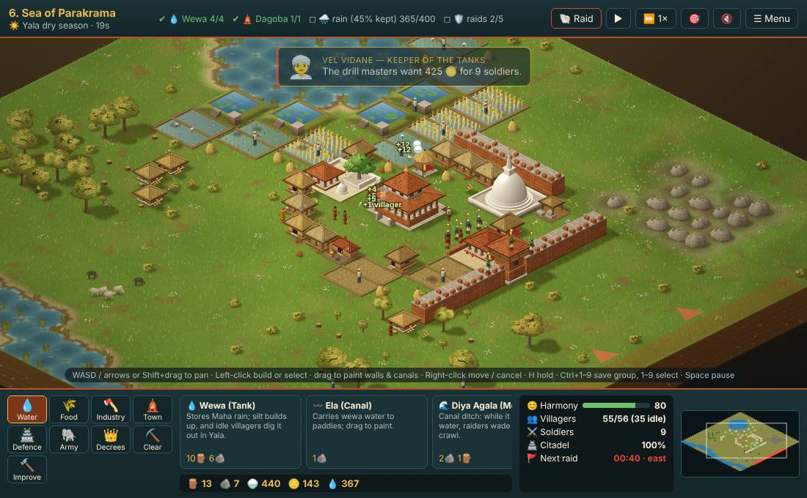
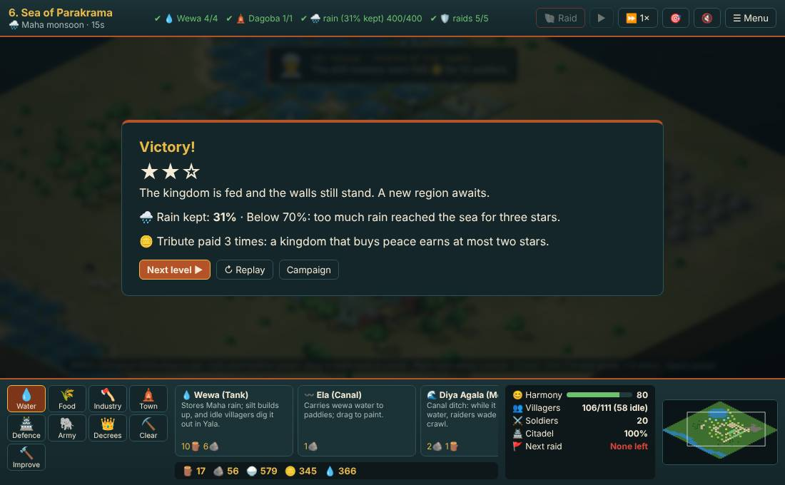
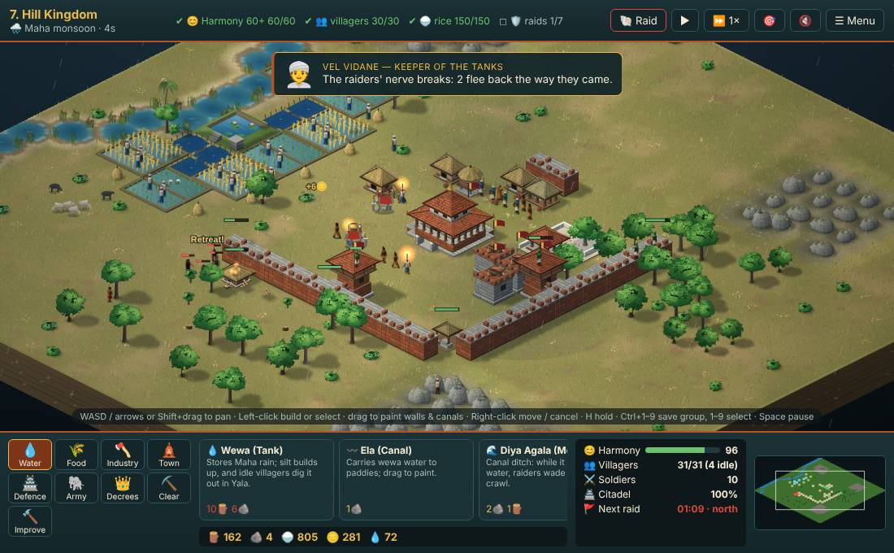
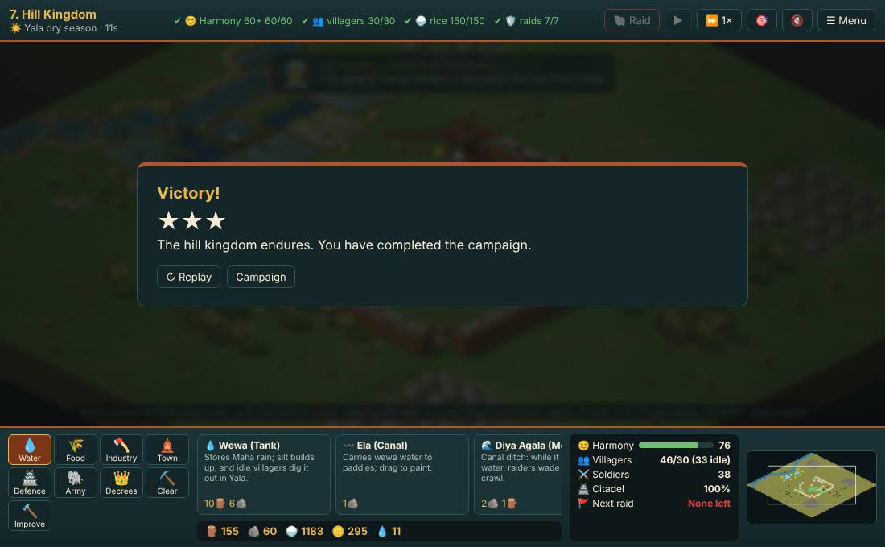
