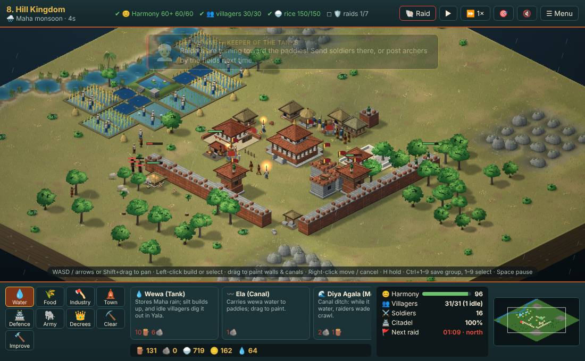
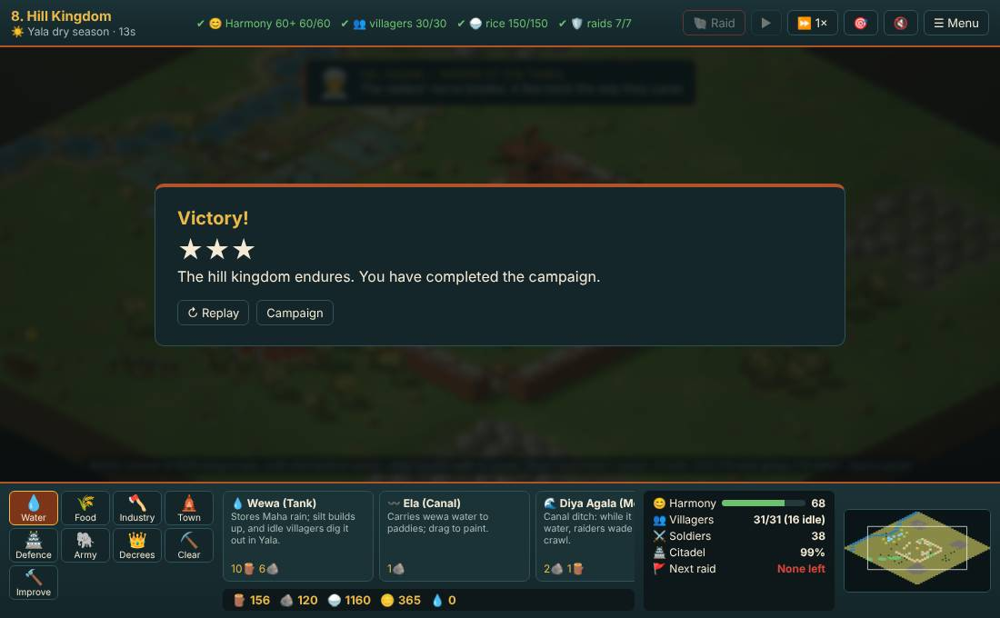

# Automated playtest report

Generated 2026-11-04 20:46 by `node tools/playtest.mjs learn`. Two bots per level: a **novice** that follows the tutorial and advisor hints, and a **learned planner** whose dials have been tuned by trial and error (see `tools/playtest-brain.json`). Bots only use player actions. They show what is *possible* and where play *stalls*; they cannot judge fun or clarity — that still needs people.

| Level | Novice | Learned planner | Planner time | Citadel | Stars | Families lost (novice / planner) | Burned |
|---|---|---|---|---|---|---|---|
| 1. Dawn at Anuradhapura | won | won | 297s | 100% | ★★★ | 0 / 0 | 0 |
| 2. Elephants of Ruhuna | won | won | 310s | 99% | ★★★ | 0 / 0 | 0 |
| 3. The Dry Zone | won | won | 411s | 100% | ★★★ | 0 / 0 | 0 |
| 4. Lion Rock | won | won | 502s | 100% | ★★★ | 0 / 0 | 2 |
| 5. The Disawa's Dam | won | won | 426s | 96% | ★★★ | 0 / 0 | 0 |
| 6. Sea of Parakrama | won | won | 509s | 100% | ★★ | 0 / 0 | 0 |
| 7. The Stair of Yapahuwa | won | won | 453s | 99% | ★★★ | 2 / 0 | 4 |
| 8. Hill Kingdom | lost | won | 721s | 99% | ★★★ | 0 / 0 | 0 |

## Findings

- **L1 Dawn at Anuradhapura:** both bots won with the citadel almost untouched (100% / 100%) and the novice lost little in the fields (4 paddies trampled). Raids may be too weak to create tension here.
- **L4 Lion Rock:** fire destroyed 2 buildings even for the planner. Check that water carriers can keep up.
- **L5 The Disawa's Dam:** raids never reached the citadel (98% / 96%) but cost the novice 12 trampled paddies: the pressure lands on the fields here.
- **L5 The Disawa's Dam:** on average 50% of villagers were idle (no job). Idle people have nothing to do; consider jobs that use them (hauling, festival crowds, militia) or a cost to idleness.
- **L7 The Stair of Yapahuwa:** fire destroyed 4 buildings even for the planner. Check that water carriers can keep up.
- **L8 Hill Kingdom:** a hint-following novice lost — the defeat screen said: 🏹 The south side had no archers or watchtowers to meet the last raid. 🔥 Fire took 4 buildings. Keep wewas full so villagers can carry water, and keep archers near the thatch. ⚔️ Only 1 soldier was trained. A barracks and a few spearmen go a long way.. Unmet: 😊 Harmony 60+ 57/60, 🛡️ raids 5/7. Consider a clearer hint or a gentler first raid here.
- **Tribute:** the learner almost never pays it (dial 0.05). Either it is priced too high or fighting is too easy.
- **Defence the learner relies on:** 2.2 towers per raid edge, 6.0 wall tiles, an army of 8.1 + 3.9 per raid. 
- **Economy the learner prefers:** 1.09 paddies per house, at most 11 houses, 2.9 woodcutters.

## Bot limits (so findings aren't over-read)

- The bots never open sluices, never use forest ambush on purpose, never repair or upgrade except for harmony, and never call raids early. The planner does send its melee soldiers out against stone throwers.
- They place buildings by simple rules (near the citadel, near water or forest), not by reading the map like a person.
- Raids involve randomness; a single run per bot is a sample, not a verdict. Learning averages several runs per candidate.

## Learning history

- L1: 43 generations, best score 1385; recent 1385 → 1385 → 1385 → 1385 → 1385
- L2: 15 generations, best score 1385; recent 1385 → 1385 → 1385 → 1385 → 1385
- L3: 46 generations, best score 1380; recent 1379 → 1379 → 1380 → 1380 → 1380
- L4: 46 generations, best score 1375; recent 1375 → 1375 → 1375 → 1375 → 1375
- L5: 15 generations, best score 1376; recent 1375 → 1375 → 1369 → 1376 → 1376
- L6: 46 generations, best score 1275; recent 1275 → 1275 → 1275 → 1275 → 1275
- L7: 3 generations, best score 1377; recent 1372 → 1377 → 1377
- L8: 56 generations, best score 1364; recent 1364 → 1364 → 1364 → 1364 → 1364

## Screens (learned planner)

